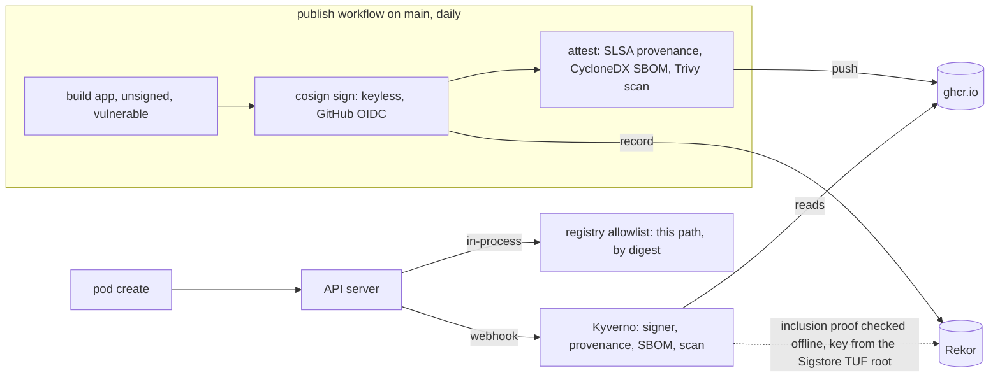

# kubernetes-supply-chain-admission

[](https://github.com/heyvaldemar/kubernetes-supply-chain-admission/actions/workflows/e2e.yml)
[](https://github.com/heyvaldemar/kubernetes-supply-chain-admission/actions/workflows/publish.yml)
[](https://github.com/heyvaldemar/kubernetes-supply-chain-admission/actions/workflows/verify.yml)
[](https://scorecard.dev/viewer/?uri=github.com/heyvaldemar/kubernetes-supply-chain-admission)
[](https://www.bestpractices.dev/projects/15464)
[](https://github.com/heyvaldemar/kubernetes-supply-chain-admission/blob/status/status.json)
[](https://github.com/heyvaldemar/kubernetes-supply-chain-admission/blob/status/status.json)

The second row of badges is not typed by hand: it is the e2e workflow's last 30 days on main, rewritten after every run by [`.github/workflows/status.yml`](.github/workflows/status.yml) into the [`status`](https://github.com/heyvaldemar/kubernetes-supply-chain-admission/tree/status) branch.

A digest pins bytes. It does not say who built them, from what, or what is inside. This repository makes a Kubernetes cluster ask before it runs an image: a signature from one known build, signed provenance that names the source, an SBOM, and a scan from the last day that read the image and found nothing critical. Kyverno checks all four at admission, and a native policy holds the registry line when Kyverno is down.

It is a reference, not a product, and it does not run in production anywhere. It runs on kind at no cloud cost. The images are not mocks: this repository's own workflow builds and signs them every day.


`make test` on a laptop, recorded with asciinema; waits are cut to two seconds and nothing else is edited. [`docs/demo/e2e.cast`](docs/demo/e2e.cast) replays it in a terminal (`asciinema play`).

## What is proven, and how

Every line is a check in `tests/e2e/run.sh` on a fresh cluster, or in `scripts/validate.sh`. The refusals are paired with a signed image that must be admitted and run, so no check can pass because the cluster refuses everything.

| Claim | Proof |
|---|---|
| An image with a signature, provenance, an SBOM and a clean scan runs | the signed demo image, by its digest from the registry today, admitted and running |
| An image the build did not sign is refused | the unsigned image, pushed by the same workflow, refused for its signature |
| A signed image with a critical vulnerability is refused | the signed and attested image whose scan found CVE-2021-36159 refused for its scan |
| A signed image is refused without each attestation | three images the publish workflow signs and then leaves one attestation off, refused for the one each lacks: provenance, SBOM, scan |
| An image signed by someone else is refused | an image signed by Sigstore's own release workflow, refused by Kyverno alone for its signer and by the native policy for its registry |
| Every image a pod uses meets the same bar, not only its containers | beside the signed image, an init container nobody signed, an image nobody signed mounted as a volume, and one from another registry, each refused; an ephemeral container added to the running pod the way `kubectl debug` adds one, refused with an image nobody signed or from another registry, admitted with the signed image (the control), and refused with Kyverno at zero ([ADR 6](docs/decisions/0006-every-image-a-pod-uses.md)) |
| A verified image cannot be swapped under its tag | the signed image referenced by tag refused |
| The policy reads one scan per image, the newest | the publish run keeps one bundle of each kind on each signed image, and the e2e run reads the registry and fails on two of a kind; the selection rule is run on planted data in Verify |
| Nothing starts while Kyverno is down | with Kyverno at zero, which removes its own webhooks as it goes, the API server's own guard ([ADR 5](docs/decisions/0005-no-image-while-kyverno-is-away.md)) refuses the unsigned image from this registry, the signed image too, an outage and not a hole, and an image from anywhere else; with Kyverno back, the unsigned image is refused for its signature again. Until 2026-10-21 this row measured the unsigned image admitted, on purpose |
| Every static check can fail | a base image by tag, a misspelled field in the allowlist binding, a signer pattern that trusts a whole account and a policy that admits when it cannot verify, each planted and each caught |

## What the run reports

From [run 40524098810](https://github.com/heyvaldemar/kubernetes-supply-chain-admission/actions/runs/40524098810), against the images published that day:

```text
PASS  by-tag: refused (images come from ghcr.io/heyvaldemar/kubernetes-supply-chain-admission/, by digest)
PASS  init-unsigned: refused (every image is signed by this repository's publish workflow on main)
PASS  no-provenance: refused (every image carries signed provenance that says it was built from this repository)
PASS  no-sbom: refused (every image carries a signed CycloneDX SBOM)
PASS  no-scan: refused (every image carries a signed scan that read its operating system's packages and found nothing critical)
PASS  other-signer: refused (images come from ghcr.io/heyvaldemar/kubernetes-supply-chain-admission/)
PASS  signed: admitted and running
PASS  unsigned: refused (every image is signed by this repository's publish workflow on main)
PASS  volume-elsewhere: refused (images come from ghcr.io/heyvaldemar/kubernetes-supply-chain-admission/, by digest)
PASS  volume-unsigned: refused (every image is signed by this repository's publish workflow on main)
PASS  vulnerable: refused (a signed scan that read its operating system's packages and found nothing critical)
PASS  another signer, Kyverno alone: refused (every image is signed by this repository's publish workflow on main)
NOTE  Kyverno removed its webhook configuration as it went down: only the API server's guard is left to refuse
PASS  with Kyverno at zero, the unsigned image from this registry: refused (failed to configure binding: no params found for policy binding with `Deny` parameterNotFoundAction)
PASS  with Kyverno at zero, the signed image too, an outage and not a hole: refused (failed to configure binding: no params found for policy binding with `Deny` parameterNotFoundAction)
PASS  with Kyverno at zero, an image from another registry: refused (failed to configure binding: no params found for policy binding with `Deny` parameterNotFoundAction)
PASS  with Kyverno at zero, an ephemeral container is refused too, the signed image included (failed to configure binding: no params found for policy binding with `Deny` parameterNotFoundAction)
PASS  with Kyverno back, the unsigned image is refused again
PASS  control: an ephemeral container with the signed image is admitted
PASS  an ephemeral container unsigned: refused (every image is signed by this repository's publish workflow on main)
PASS  an ephemeral container from another registry: refused (images come from ghcr.io/heyvaldemar/kubernetes-supply-chain-admission/, by digest)
```

Anyone can check the same images without a cluster; `scripts/verify-published.sh` runs these checks, and the three attestation types, in every e2e run:

```bash
cosign verify ghcr.io/heyvaldemar/kubernetes-supply-chain-admission/app:latest \
  --certificate-identity https://github.com/heyvaldemar/kubernetes-supply-chain-admission/.github/workflows/publish.yml@refs/heads/main \
  --certificate-oidc-issuer https://token.actions.githubusercontent.com
cosign verify-attestation --type slsaprovenance1 ghcr.io/heyvaldemar/kubernetes-supply-chain-admission/app:latest \
  --certificate-identity https://github.com/heyvaldemar/kubernetes-supply-chain-admission/.github/workflows/publish.yml@refs/heads/main \
  --certificate-oidc-issuer https://token.actions.githubusercontent.com
```

## How it works



- **Publish** (`.github/workflows/publish.yml`): three demo images, built for amd64 and arm64. `app` and `vulnerable` are signed with the workflow's own identity, and each gets three signed attestations: SLSA v1 provenance written in the job, a CycloneDX SBOM from Syft, and a Trivy scan. `unsigned` is pushed and never signed. The scan is re-run daily.
- **Verification** (`policies/verify-images.yaml`): one Kyverno ImageValidatingPolicy, `failurePolicy: Fail`, bound to namespaces labelled `supply-chain.heyvaldemar.com/verified`. One exact signer; the provenance must name this repository; the scan must contain an operating system's packages and no critical finding.
- **The floor** (`policies/registry-allowlist.yaml`): a ValidatingAdmissionPolicy the API server evaluates itself. Images come from this repository's registry path, by digest.
- **Kyverno** (`scripts/install-kyverno.sh`, `kyverno/`): the chart pinned by version, every image it runs pinned by digest.

## Quickstart

Needs Docker. The tools (kind, kubectl, helm, kubeconform) are installed at pinned versions and hashes into `.cache/bin`. Nothing is built or signed locally; the cluster pulls the images the publish workflow pushed last.

```bash
make up      # kind cluster, Kyverno, the namespace and both policies
make test    # the full e2e suite
make check   # the static checks and their planted violations
make down
```

## Cost

Nothing in a cloud. The cluster is kind on one machine; the images live in GitHub's registry, free for a public repository, and Sigstore's public instance is free. CI is two GitHub-hosted runs a day: the publish workflow (build, sign, attest, scan) and a fresh kind cluster with every check, two to three minutes each. On EKS the cost is Kyverno's admission controller at three replicas. And latency: each new pod waits on the registry and the transparency log.

## What it does not do

The [threat model](docs/threat-model.md) lists every threat with its control and check, five findings from the build, and what is not covered: a scan is only as fresh as the last publish run; the provenance is written by the job that builds, which makes it Build L1 by SLSA v1.0's text; a running pod is not re-checked when its image's scan turns critical; the registry is on the admission path.

The [Cyber Resilience Act mapping](docs/cyber-resilience-act.md) takes each control to the clause of Regulation (EU) 2024/2847 it produces evidence for, Article 13(5)'s due diligence on third-party components first, and says what each leaves out: the 24-hour reporting that applies since 11 September 2026, the support period and the conformity assessment are processes, and no pipeline carries them.

## Repository

```text
images/               the three demo images: app, unsigned, vulnerable
.github/workflows/    publish (build, sign, attest), e2e, verify, scorecard
policies/             the Kyverno image policy and the native registry allowlist
manifests/            the verified namespace
kind/ kyverno/        the cluster and Kyverno's chart, values and image pins
tests/e2e/            the checks against a running cluster, and the planted pods
tests/static/         the planted violations for the static checks
scripts/              install the tools and Kyverno, the static checks
docs/                 the threat model, the decisions and the Cyber Resilience Act mapping
```

## Decisions

[`docs/decisions/`](docs/decisions/): Kyverno's ImageValidatingPolicy over a second admission engine; keyless signing pinned to one workflow; provenance, an SBOM and a scan as gates; a native floor under the webhook. Each ends with how the choice would be explained to a customer.

This repository is the supply chain half of [aws-eks-reference-platform](https://github.com/heyvaldemar/aws-eks-reference-platform), whose threat model lists unsigned images as its largest open risk. The [agent sandbox](https://github.com/heyvaldemar/kubernetes-ai-agent-sandbox) is the other piece next to it, and [kubernetes-postgres-recovery](https://github.com/heyvaldemar/kubernetes-postgres-recovery) the database a tenant would run, restored every day three ways.

## Questions, bugs and changes

Open an [issue](https://github.com/heyvaldemar/kubernetes-supply-chain-admission/issues) for a bug, a question or an idea. Security reports go privately, as [SECURITY.md](SECURITY.md) describes. Changes are welcome as pull requests: CI runs the same checks on them as on main, and a change ships with the check that proves it.

## How this is built

One maintainer and an AI agent. The agent writes most of the code; the decisions are mine, and so is the verification. Nothing merges on the agent's report that it works: it merges on the checks above, and each of them has been shown the failure it exists to catch. The rules the agent works under are in [AGENTS.md](AGENTS.md). The empty scan and the `.predicate` path in the threat model came from checks that failed during the build.

## License

[MIT](LICENSE).
